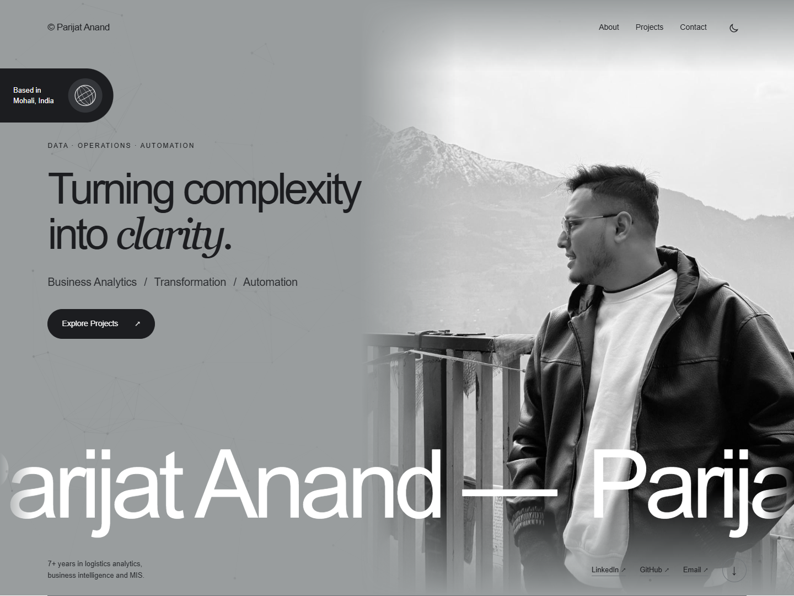
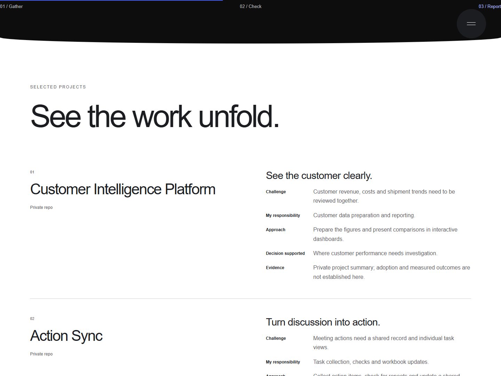

# Parijat Anand — Portfolio

Reporting, business decisions and workflow automation in logistics.

[Visit the portfolio](https://parijat9.github.io/) · [View résumé](https://parijat9.github.io/assets/parijat-anand-resume.pdf)

## The website



Six projects covering customer reporting, meeting follow-up, freight billing, shipment issues, capacity planning and data checks. Each explains the challenge, responsibility, approach, decision supported and available evidence.



Screenshots captured from the published website on 20 October 2026.

## Run locally

```sh
python -m http.server 8000
```

Open http://localhost:8000. No package installation or build step is required.

- `index.html`: content and page structure.
- `style.css` and `story.css`: layout, responsive styles and transitions.
- `app.js` and `story.js`: navigation, motion and project previews.
- `reports/`: public demonstration reports.

GitHub Pages publishes the `main` branch. The site supports keyboard navigation, reduced motion and a motion pause control.
